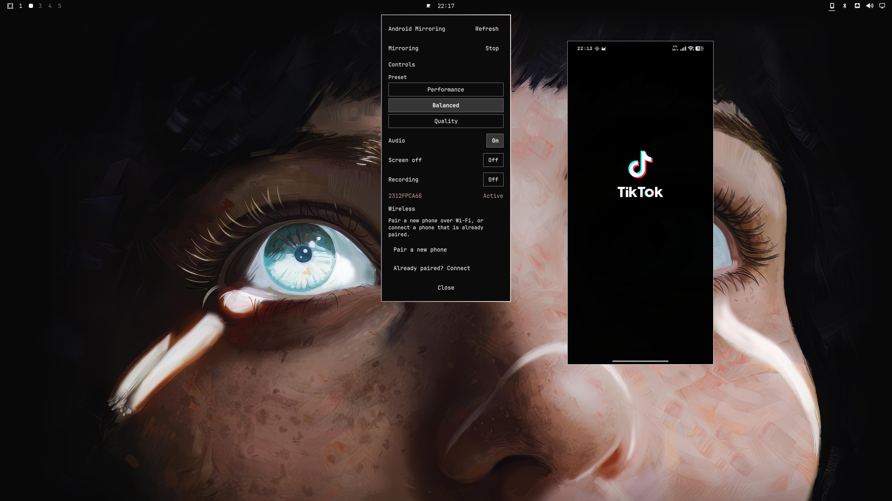
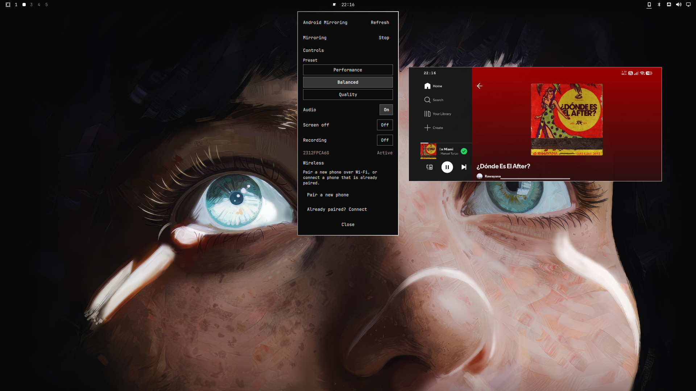
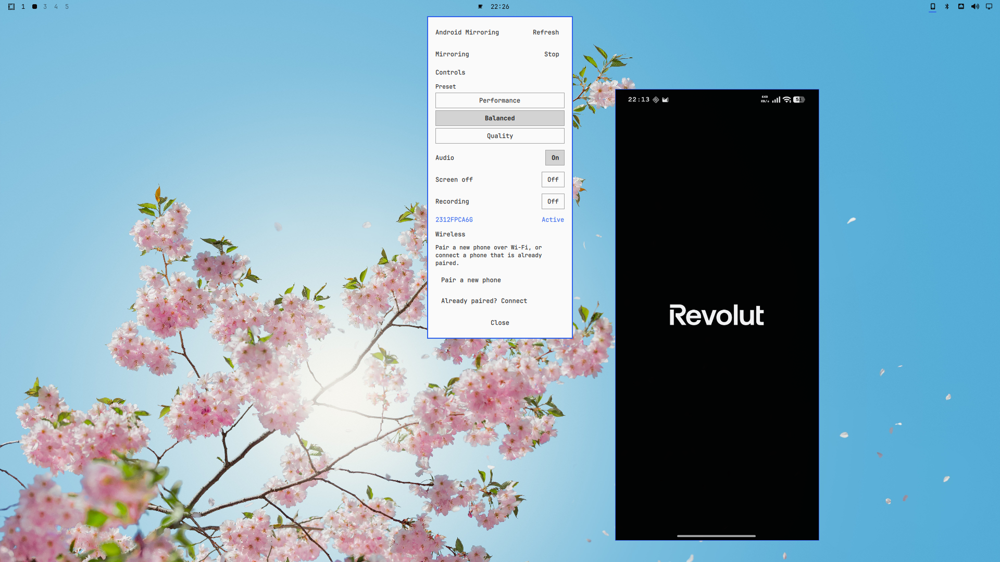
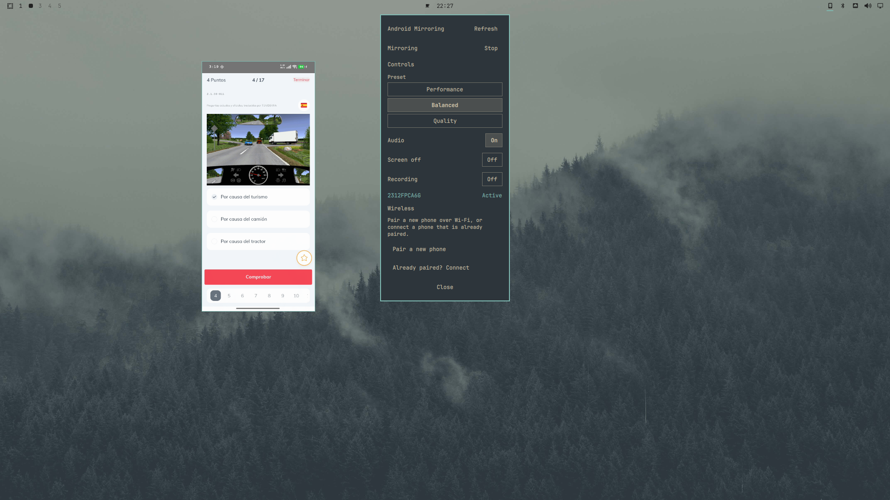

# Android Mirroring — Omarchy plugin v0.1






A third-party [Omarchy](https://omarchy.org/) Quattro plugin that adds an
Android device mirroring widget to the Omarchy shell. It discovers Android
phones and tablets over USB or Android 11+ Wireless Debugging and launches the
upstream [scrcpy](https://github.com/Genymobile/scrcpy) mirroring engine under
a Quattro-native Hyprland floating window.

This product is the Omarchy-native interface, device/session layer, and
integration. It is **not** a fork or reimplementation of scrcpy.

## Features

- USB device discovery via `adb devices -l`.
- Android 11+ Wireless Debugging pair/connect flow with a masked six-digit
  pairing code.
- Saved wireless device metadata for one-tap reconnect after an Omarchy shell
  restart.
- Update Address flow for wireless endpoints that change port.
- Three mirroring presets: **Performance**, **Balanced** (default), and
  **Quality**.
- Audio On/Off.
- Screen off On/Off.
- Session recording On/Off with timestamped `.mp4` files.
- Quattro-native panel theming and a thin, theme-aware border on the floating
  phone window.
- Tracked scrcpy/ADB processes — only the plugin's own processes are stopped.

## Requirements

Verified target environment:

- Omarchy 4.0.0-1
- Hyprland 0.56.2
- Quickshell 0.3.0
- scrcpy 4.1
- android-tools 37.0.0 (adb 1.0.41)

Device requirements:

- USB: Android 5.0 (API 21) or newer with Developer options and USB debugging
  enabled.
- Audio forwarding requires Android 11 (API 30) or newer, matching upstream
  scrcpy support.
- Wireless: Android 11 or newer with Wireless Debugging enabled.

## Dependencies

The plugin calls the system `scrcpy` and `adb` binaries directly. Install them
with the Omarchy package manager before installing the plugin:

```bash
omarchy pkg add scrcpy android-tools
```

- `scrcpy` is the upstream mirroring engine.
- `android-tools` provides the ADB client. The `scrcpy` package depends on
  `android-tools`, but listing both keeps the setup explicit.

These are ordinary system packages. The plugin does **not** install them
automatically, and the plugin should not be run as root.

## Installation

Install from the public GitHub repository:

```bash
omarchy plugin add https://github.com/camburalex/android-mirroring-omarchy.git --enable
```

If you are installing from a fork or a local copy, replace the URL with your
public repository URL. The plugin must come from a public GitHub repository
before it can be submitted to omarchyplugins.com.

`--enable` performs the native install and enable step, so no manual rescan is
required. If you need to manually reload plugins during development or
troubleshooting, you can run:

```bash
omarchy-shell shell rescanPlugins
```

Validate the installed plugin:

```bash
omarchy plugin validate ~/.config/omarchy/plugins/dev.android-mirroring
```

### Update

```bash
omarchy plugin update dev.android-mirroring
```

### Hyprland integration

The plugin ships a `hyprland.lua` rule that floats, centers, and applies a
thin border to the plugin-owned scrcpy phone window while inheriting the
active Omarchy theme. This rule is **not** installed automatically.

Add the following guarded loader to your `~/.config/hypr/hyprland.lua`,
**after** `require("default.hypr.omarchy")` (so the `o.window` helper is
available):

```lua
do
    local path = (os.getenv("HOME") or "")
        .. "/.config/omarchy/plugins/dev.android-mirroring/hyprland.lua"
    local file = io.open(path, "r")

    if file then
        file:close()
        dofile(path)
    end
end
```

The guard checks for the plugin directory, so Hyprland still loads cleanly
if the plugin is removed later. Apply and validate the change:

```bash
hyprctl reload
hyprctl configerrors
```

Do not edit `/usr/share/omarchy/`; only edit your user-owned
`~/.config/hypr/hyprland.lua`.

The rule matches windows where `class = "^scrcpy$"` and
`initial_title = "^Android Mirroring$"`. The fixed title is set by the
plugin via `--window-title=Android Mirroring` so user-launched scrcpy
sessions keep their default titles and are not affected.

## USB setup and use

1. On the Android device, enable **Developer options**.
2. Enable **USB debugging**.
3. Connect the device to the computer with a USB cable.
4. Approve the "Allow USB debugging?" prompt that appears on the phone.
5. Open the Android Mirroring bar widget and press **Refresh**.
6. When the device row shows **USB · Ready**, press **Mirror**.

Some devices, especially Xiaomi-family devices, may require the additional
**USB debugging (Security Settings)** option for keyboard and mouse input
injection, sometimes followed by a reboot. This is vendor-specific and
separate from ordinary USB debugging. If the mirror image appears but input
does not work, check that option in the phone's developer settings.

## Wireless mirroring (Android 11+)

The wireless flow uses Android's **Wireless Debugging**. The plugin never
stores the six-digit pairing code.

### First-time pairing

1. Open the Android Mirroring bar widget.
2. In the **Wireless** section, press **Pair a new phone**.
3. On the Android device, enable **Wireless Debugging** (Settings → Developer
   options).
4. Note the main **Wireless debugging** IP address and port shown on that
   screen.
5. Enter that address and port in the plugin as the **Wireless IP & port**,
   then press **Next: Pair device**.
6. On the Android device, tap **Pair device with pairing code**. Keep the
   popup open until pairing finishes.
7. In the plugin, enter the **Pairing IP & port** and the **Pairing code**
   shown in the popup, then press **Pair & Connect**.
8. If pairing succeeds, the plugin automatically runs `adb connect` and
   refreshes the device list. The phone appears as **Wireless · Ready**.

### Already paired?

1. In the plugin, press **Already paired? Connect**.
2. Enter the main **Wireless debugging** IP address and port.
3. Press **Connect**.

Pairing normally persists, but Android may require pairing again if the trust
relationship is revoked or forgotten.

### Reconnecting after a restart

Saved wireless phones appear in the device list as **Wireless · Unavailable**
when they are not currently reachable. Press **Reconnect** to run
`adb connect <last-known-endpoint>`.

### Update Address

Android may change the wireless debugging port. Press **Update** on a saved
row, enter the new main endpoint, then press **Connect**. The saved record is
updated without requiring a new pairing.

Important notes:

- The main **Wireless debugging** endpoint and the popup **pairing endpoint**
  are usually different ports. Both are required for first-time pairing.
- The six-digit pairing code is a transient credential. It is written to ADB
  stdin and is never saved, logged, or shown again.
- Pairing normally persists, but Android may require pairing again if the
  trust relationship is revoked or forgotten.
- **Wireless Debugging** must be enabled whenever the user wants to connect or
  use a wireless mirroring session. It may be turned off between sessions and
  must be re-enabled before reconnecting.
- QR pairing is not supported in v0.1.
- Wireless liveness detection and the final M6 release validation were performed
  with IPv4-style ADB endpoints. IPv6 wireless endpoints are not guaranteed in
  v0.1.

## Usage

1. Open the Android Mirroring bar widget from the Omarchy bar.
2. Press **Refresh** to list connected devices.
3. Select a **Preset**, toggle **Audio**, **Screen off**, and **Recording** as
   desired.
4. Press **Mirror** on a **USB · Ready** or **Wireless · Ready** device.
5. scrcpy opens in a floating phone window. Press **Stop** in the widget or
   close the scrcpy window to end the session.

The widget closes automatically once the plugin confirms scrcpy has started,
so pre-start validation and recording-preparation errors remain visible.

## Presets

| Preset      | max size | bit rate | max FPS | Use case                                     |
|-------------|----------|----------|---------|----------------------------------------------|
| Performance | 1024     | 4 M      | 30      | Lower latency on slower networks or older PCs. |
| Balanced    | 1600     | 8 M      | 60      | Default. Good balance of quality and latency.  |
| Quality     | 2560     | 16 M     | 60      | Sharper image on fast networks.              |

The default is **Balanced**. Presets reset to Balanced when the Omarchy shell
restarts.

## Audio, Screen off, and Recording

- **Audio**: forwards the Android device audio to the computer when On.
- **Screen off**: turns off the physical device screen while mirroring. Input
  continues to work through the scrcpy window.
- **Recording**: saves the mirrored session to an `.mp4` file. The directory is
  the standard user **Videos/Movies** location with an `Android Mirroring`
  subfolder (usually `~/Videos/Android Mirroring`). File names are timestamped
  and look like `android-mirroring-YYYYMMDD-HHMMSS-XXXXXX.mp4`.

If scrcpy fails before it starts writing, the reserved `.mp4` placeholder is
removed. If recording is On, the selected Audio state is included in the
recording.

## Theming and window behavior

The bar widget uses the standard Omarchy panel theme tokens
(`Style`, `Color.foreground`, `Color.accent`, `Color.urgent`).

The scrcpy phone window is launched with `SDL_VIDEODRIVER=x11`, which runs it
under XWayland on the verified Omarchy target. This was chosen because current
hardware testing showed that XWayland correctly resizes the outer floating
window when the phone rotates between portrait and landscape. Native Wayland
behavior may vary by device and environment.

The Hyprland rule sets a 1 px border, floating, centered layout. Border color
and rounding are inherited from the active Omarchy theme automatically.

## Configuration

The plugin has no separate user-editable application configuration file.
The one manual integration step is the guarded Hyprland loader described
above. Saved wireless devices are plugin-managed state, not a configuration
file; they are stored in the Quickshell state directory, typically:

```
~/.local/state/quickshell/by-shell/<shell-id>/dev.android-mirroring.saved-devices.json
```

Pairing codes, passwords, and unknown fields are never persisted. You may
delete this file to remove all saved wireless history.

## Troubleshooting

| Symptom | Likely cause and fix |
|---------|----------------------|
| "scrcpy not found" or `scrcpy` missing | Run `omarchy pkg add scrcpy android-tools` and restart the shell. |
| `adb devices -l` not found | `android-tools` is missing or not on PATH. Install with `omarchy pkg add scrcpy android-tools`. |
| Device shows **Authorization required** | Accept the USB debugging prompt on the phone. Re-plug the cable and press Refresh if needed. |
| No devices detected | Enable USB debugging or Wireless Debugging. Check the cable. Run `adb devices -l` directly. |
| Wireless pairing fails | The pairing popup expired (reopen it), the address or code is wrong, or the phone and computer are not on the same network. |
| Saved phone shows **Wireless · Unavailable** | The wireless debugging port may have changed. Use **Update** to enter the new endpoint and **Connect**. |
| Mirror image appears but input does not work | Some devices, especially Xiaomi-family devices, may require the additional "USB debugging (Security Settings)" option for input injection, sometimes followed by a reboot. Check the phone's developer/security settings. |
| Hyprland rule not applied | Run `hyprctl reload` and `hyprctl configerrors`. Ensure the guard block was added after `require("default.hypr.omarchy")`. |
| Session shows "Mirroring ended unexpectedly" | scrcpy exited with an error. Check `adb devices -l`, scrcpy output, and the diagnostics list below. |

## Diagnostics

If something is not working, gather this information:

```bash
omarchy plugin validate ~/.config/omarchy/plugins/dev.android-mirroring
omarchy-shell shell ping
omarchy-shell shell listPlugins
adb devices -l
scrcpy --version
adb version
hyprctl configerrors
```

Do **not** share pairing codes, saved device state, or unrelated personal files
when asking for help.

## Uninstall

Remove the plugin:

```bash
omarchy plugin remove dev.android-mirroring
```

The `scrcpy` and `android-tools` packages are system dependencies and are not
removed automatically. The saved device state file in Quickshell's state
directory is also not deleted by `omarchy plugin remove`; remove it manually if
you want a clean state.

The small guarded Hyprland loader block in
`~/.config/hypr/hyprland.lua` becomes inert after the plugin is removed and
does not break Hyprland. If you want to remove it entirely, delete the
`do ... end` block that opens `~/.config/omarchy/plugins/dev.android-mirroring/hyprland.lua`.

## Brief architecture

The plugin runs as a `bar-widget` inside the existing `omarchy-shell`
Quickshell process:

```
Omarchy bar widget
  → qml/DeviceManager.qml (adb discovery)
  → qml/WirelessManager.qml (wireless pair/connect)
  → qml/SavedDeviceStore.qml (persisted known devices)
  → qml/ScrcpyBackend.qml (tracked scrcpy process)
  → qml/BarWidget.qml (panel UI and options)
  → external scrcpy rendering window
  → hyprland.lua (floating phone window rules)
```

For v0.1 the video stream is **not** embedded, proxied, or redecoded. The
plugin builds a safe `scrcpy` argv, launches it as a tracked Quickshell
`Process`, and lets scrcpy own the video, audio, and input.

## Attribution

Created and maintained by [@camburalex](https://github.com/camburalex).

This plugin is an independent Omarchy integration and is **not** a fork or
reimplementation of [scrcpy](https://github.com/Genymobile/scrcpy). scrcpy is
developed by Genymobile, Romain Vimont, and contributors and is licensed under
the Apache License 2.0. It is installed separately and is the upstream external
mirroring backend.

## License

This plugin's own original code is released under the MIT License. See
[LICENSE](./LICENSE).

scrcpy remains under its own Apache License 2.0 and is not covered by this
project's MIT license.

## Roadmap

Post-v0.1 ideas:

- QR-code wireless pairing.
- Improved device discovery and reconnect.
- Richer keyboard/focus navigation in the panel.
- Optional future backend research; a custom Android backend is not a
  near-term promise.
